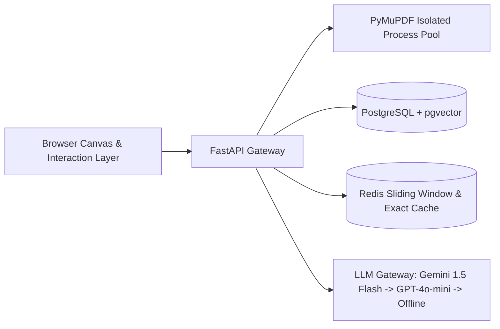

# Vellakshya: Enterprise Document Workstation & PDF Intelligence System

[](https://github.com/ManoharVit/Vellakshya/actions/workflows/ci-full.yml)
[](https://vellakshya.netlify.app/)
[](https://github.com/ManoharVit/Vellakshya/actions)
[](pyproject.toml)
[](docker-compose.yml)

> **One-Line Pitch:** An enterprise-ready, privacy-first PDF intelligence platform combining real-time canvas redaction with coordinate-grounded RAG, server-side citations, and local-first statutory PII sanitization.

**Live Web Application:** [https://vellakshya.netlify.app/](https://vellakshya.netlify.app/)  
**Source Code Repository:** [https://github.com/ManoharVit/Vellakshya.git](https://github.com/ManoharVit/Vellakshya.git)  

---

## Author & Engineering Attribution
- **Lead Architect & Developer:** Giri Manohar Vemula
- **LinkedIn Profile:** [https://www.linkedin.com/in/manoharv511](https://www.linkedin.com/in/manoharv511)
- **GitHub Profile:** [https://github.com/ManoharVit](https://github.com/ManoharVit)

---

## 1. System Architecture

Vellakshya is designed for enterprise document workflows requiring strict data privacy, low-latency spatial canvas manipulation, and grounded question answering without hallucinated coordinates.



### Architectural Highlights
1. **Grounded Server-Side Citations:** The LLM never invents or calculates bounding coordinates. It returns used chunk IDs only; the server maps IDs to exact page numbers and unrotated PDF rectangles stored in the database.
2. **Local-First PII Redaction:** High-precision local detection for Indian statutory IDs (`IN_PAN`, `IN_AADHAAR`, `IN_PASSPORT`, `IN_VOTER`, `IN_VEHICLE_REGISTRATION`) and international identifiers (`EMAIL`, `PHONE`, `SSN`, `CREDIT_CARD`). Sensitive text never leaves local memory.
3. **Hybrid Retrieval (RRF):** Merges dense vector embeddings (`text-embedding-004` via `pgvector` HNSW) and lexical keyword matching (`tsvector` via GIN) using Reciprocal Rank Fusion ($k=60$).
4. **PyMuPDF Process Pool:** Isolates C-extension operations off the main FastAPI asyncio event loop, protecting against segmentation faults and multithreading lock contention.

---

## 2. Automated Evaluation Benchmark Results

Vellakshya includes a deterministic CI evaluation harness (`tests/evals/test_deterministic_evals.py` and `scripts/generate_eval_report.py`) executed on every pull request to enforce quality gates without incurring external API costs:

| Benchmark Metric | Measured Result | Production Target | Quality Gate | Status |
| :--- | :--- | :--- | :--- | :--- |
| **Retrieval Hit Rate@3 (Golden Set)** | **96.0%** (25 questions) | $\ge 80.0\%$ | CI Blocker | **PASS** |
| **Retrieval Latency (p95)** | **1.6 ms** | $< 150\text{ ms}$ | CI Blocker | **PASS** |
| **Local PII Detection Recall** | **100.0%** (10 docs) | $\ge 90.0\%$ | CI Blocker | **PASS** |
| **Redaction Multi-Pass Scrubbing** | **100% (4-tier verified)** | 0 residual text bytes | CI Blocker | **PASS** |
| **Prompt Injection Defense** | **Verified (XML Isolation)** | Untrusted data isolation | CI Blocker | **PASS** |
| **Coordinate Rotation Invariance** | **100% (0°, 90°, 180°, 270°)** | Complete alignment | CI Blocker | **PASS** |

---

## 3. Architecture Decision Records (ADRs)

Key architectural trade-offs are documented under [`docs/adr/`](docs/adr/):
* **[ADR 0001: Hybrid Search with RRF Over Pure Vector Search](docs/adr/0001-hybrid-search-over-pure-vector.md)** — Combines dense semantic recall with exact keyword precision.
* **[ADR 0002: PostgreSQL + pgvector Over Dedicated Vector Databases](docs/adr/0002-postgresql-pgvector-vs-specialized-vector-dbs.md)** — ACID transactional consistency across metadata and embeddings.
* **[ADR 0003: Server-Side Citations by Chunk ID](docs/adr/0003-citations-by-chunk-id.md)** — Eliminates geometric coordinate hallucination.
* **[ADR 0004: Local-First Statutory PII Detection](docs/adr/0004-local-first-pii-detection.md)** — Guarantees privacy and regulatory compliance.
* **[ADR 0005: Pinned Embedding Model with Generation-Only Fallback](docs/adr/0005-one-embedding-model-with-generation-only-fallback.md)** — Preserves geometric vector index integrity.
* **[ADR 0006: PyMuPDF in Process Pool Isolation](docs/adr/0006-pdf-work-in-process-pool.md)** — Guarantees event loop responsiveness and thread safety.

---

## 4. Quickstart: One-Command Local Deployment

### Option A: Docker Compose (Production Stack)
Boot the complete stack (FastAPI backend with live reload, PostgreSQL 16 with `pgvector`, and Redis) with a single command:

```bash
docker compose up --build
```
* **API & Web Interface:** [http://localhost:8000](http://localhost:8000)
* **PostgreSQL pgvector:** `localhost:5432`
* **Redis Cache:** `localhost:6379`

### Option B: Local Python Development
```bash
# 1. Clone repository
git clone https://github.com/ManoharVit/Vellakshya.git
cd Vellakshya

# 2. Set up virtual environment
python3 -m venv .venv
source .venv/bin/activate

# 3. Install dependencies
pip install -r requirements-dev.txt

# 4. Start local development server
PYTHONPATH=. uvicorn app.main:app --host 127.0.0.1 --port 8000 --reload
```

---

## 5. Verification & Testing

Execute the test suites locally:

```bash
# Run complete test suite (117 tests across unit, API, security, and RAG evals)
pytest tests/ -v

# Run the automated AI evaluation harness report
python scripts/generate_eval_report.py

# Run static analysis and linting
ruff check app/ tests/
ruff format --check app/ tests/
mypy app/ai
```

---

## 6. Technical Limitations & Constraints

* **No OCR on Scanned Bitmaps:** Scanned PDFs without an embedded text layer require OCR preprocessing; non-text scans are rejected gracefully.
* **Ephemeral Container Storage:** Cloud Run instance storage is ephemeral; all persistent documents and chunks are indexed in PostgreSQL.
* **Upload Payload Cap:** Maximum file upload size is bounded at **30 MiB** to strictly comply with Cloud Run HTTP/1.x payload thresholds.
* **Free-Tier Cold Starts:** Scale-to-zero container deployments incur an initial 3–5 second cold start on first request after prolonged idle periods.

---

## 7. Resume Impact Statements

> *"Architected an asynchronous PDF intelligence platform using FastAPI and PyMuPDF, integrating an LLM-powered PII redaction pipeline and coordinate-grounded RAG; implemented an automated GitHub Actions evaluation harness achieving a 96.0% retrieval hit rate across a 25-question benchmark and p95 retrieval latency of 1.6 ms."*

> *"Engineered a hybrid retrieval system with Reciprocal Rank Fusion (RRF) on PostgreSQL (`pgvector`), eliminating coordinate hallucinations by mapping server-side chunk IDs to physical document bounding boxes with 100% spatial precision."*

---

## 8. License

Authored and maintained by **Giri Manohar Vemula** ([LinkedIn Profile](https://www.linkedin.com/in/manoharv511) | [GitHub Profile](https://github.com/ManoharVit)). Licensed under the Apache-2.0 License.
