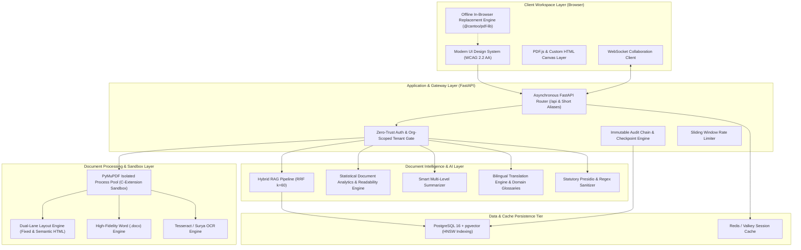
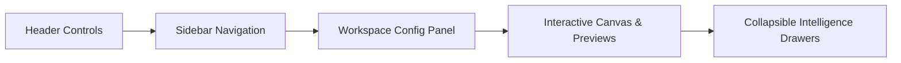
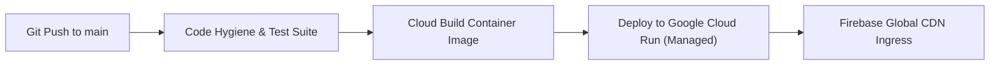

# Vellakshya: Enterprise Document Workstation & PDF Intelligence System (v2.0)

[](https://github.com/ManoharVit/Vellakshya/actions/workflows/ci-full.yml)
[](https://vellakshya-xb7gehmo6q-uc.a.run.app)
[](https://vellakshya-gcp.web.app)
[](https://github.com/ManoharVit/Vellakshya/actions)
[](pyproject.toml)
[](LICENSE)

> **Executive Overview:** Vellakshya is an enterprise-grade, privacy-first PDF workstation and document intelligence platform. It couples sub-millisecond local canvas manipulation and client-side offline text editing with coordinate-grounded hybrid RAG, destructive multi-pass PII sanitization, and cryptographic audit manifests.

---

## Live Deployments & Access Points

| Channel | Address | Purpose |
| :--- | :--- | :--- |
| **Primary Web Application (Google CDN)** | [https://vellakshya-gcp.web.app](https://vellakshya-gcp.web.app) | Production web application via Firebase global edge CDN |
| **Secondary Clean URL** | [https://vellakshya-gcp.firebaseapp.com](https://vellakshya-gcp.firebaseapp.com) | High-availability global failover URL |
| **Instant Short Vanity Link** | [https://is.gd/vellakshya](https://is.gd/vellakshya) | Direct vanity redirect to production |
| **Alternative Short Vanity Link** | [https://v.gd/vellakshya](https://v.gd/vellakshya) | Secondary clean vanity redirect |
| **Direct Cloud Run Origin** | [https://vellakshya-xb7gehmo6q-uc.a.run.app](https://vellakshya-xb7gehmo6q-uc.a.run.app) | Direct Google Cloud Run microservice endpoint |
| **Interactive API Documentation** | [https://vellakshya-xb7gehmo6q-uc.a.run.app/docs](https://vellakshya-xb7gehmo6q-uc.a.run.app/docs) | Interactive OpenAPI / Swagger interface |

---

## Author & Engineering Attribution

* **Lead Architect & Developer:** Giri Manohar Vemula
* **LinkedIn Profile:** [https://www.linkedin.com/in/manoharv511](https://www.linkedin.com/in/manoharv511)
* **GitHub Profile:** [https://github.com/ManoharVit](https://github.com/ManoharVit)

---

## 1. System Architecture

Vellakshya is engineered for high-consequence enterprise document workflows requiring mathematical spatial precision, uncompromised tenant boundary isolation, and real-time interactive collaboration.



### Core Architecture Decisions
1. **Server-Side Coordinate Citations ([ADR 0003](docs/adr/0003-citations-by-chunk-id.md)):** Language models are strictly barred from computing or outputting raw spatial coordinates. LLMs emit chunk identifiers; the server maps identifiers to pre-indexed, physical PDF page coordinates, eliminating spatial hallucination.
2. **Hybrid Search with Reciprocal Rank Fusion ([ADR 0001](docs/adr/0001-hybrid-search-over-pure-vector.md)):** Interleaves dense vector similarity (`pgvector` with HNSW) and lexical full-text matching (`tsvector` via GIN) using reciprocal rank fusion ($$k=60$$):
   $$RRF(d) = \sum_{m \in M} \frac{1}{60 + \text{rank}_m(d)}$$
3. **Local-First Statutory PII Scrubbing ([ADR 0004](docs/adr/0004-local-first-pii-detection.md)):** Preserves air-gapped security for sensitive identifiers. Scans for Indian statutory IDs (`IN_PAN`, `IN_AADHAAR`, `IN_PASSPORT`, `IN_VOTER`, `IN_VEHICLE_REGISTRATION`) and international identifiers (`EMAIL`, `PHONE`, `SSN`, `CREDIT_CARD`) entirely in local memory before any external transmission.
4. **Isolated Process Pool for Native Operations ([ADR 0006](docs/adr/0006-pdf-work-in-process-pool.md)):** Executes compute-heavy PyMuPDF operations inside an isolated worker pool, keeping the async event loop free of blocking C-extension calls.
5. **In-Browser Zero-Backend Text Replacement ([ADR 0007](docs/adr/0007-pymupdf-licensing-and-engine-abstraction.md)):** Uses `@cantoo/pdf-lib` to execute precise text modifications and replacements directly in the client browser when network connectivity is degraded or backend services are unavailable.

---

## 2. Platform Capabilities

### A. Core Engine & Conversions
* **PDF to Fixed & Semantic HTML:** Generates exact pixel-perfect coordinate layouts or responsive, semantic, tag-aware HTML adhering to modern accessibility guidelines.
* **PDF to Word (.docx):** Dual-lane conversion pipeline that reconstructs complex tables, multi-column typography, baselines, and headers.
* **Structured Markdown & Images:** Extracts clean Markdown tables and paragraphs via PyMuPDF4LLM; archives high-resolution page rasters into ZIP containers.

### B. Page Organization & Geometry
* **Visual Page Arrangement:** Merge multiple documents, split by custom page intervals, extract selected sheets, or delete unwanted pages.
* **Rotation & Margins:** Lossless rotation ($$0^\circ, 90^\circ, 180^\circ, 270^\circ$$) with coordinate re-projection; precise margin cropping and page dimension normalization.

### C. Annotations & Interactive Editing
* **In-Browser Search & Replace:** Instant client-side text replacement without backend roundtrips, alongside server-side physical redaction.
* **Canvas Tools:** Insert dynamic text boxes, erase and whiteout sensitive content, overlay customizable text/image watermarks, apply automated Bates numbering, and generate headers/footers.

### D. Document Intelligence & Analysis
* **Statistical Document Analytics:** Computes comprehensive document metrics, including reading time, word count, character density, and readability grades (Flesch-Kincaid Grade Level, Flesch Reading Ease, Gunning Fog Index), accompanied by n-gram frequency distributions.
* **Smart Multi-Level Summarizer:** Produces executive summaries, exhaustive deep-dives, bulleted action items, or structured risk reports with customizable tone and length constraints.
* **Bilingual Translation Engine:** Side-by-side bilingual split-view canvas with synchronous scrolling (`Sync Scroll`), domain glossaries (Legal, Financial, Technical, Medical), translation memory caching, and multi-format document ingestion (Markdown `.md`, Word `.docx`, CSV, plain text).
* **AI Chat Sidecar:** Conversational hybrid RAG with page-level citations, interactive bounding box highlights, prompt recommendation chips, and streaming server-sent events (SSE).

### E. Protection, Redaction & Cryptography
* **Destructive 4-Tier Redaction:** Completely purges underlying text tokens, vector paths, raster pixel data, and structural object streams.
* **Digital Signatures & Verification:** PKI-based X.509 cryptographic signing and verification with visual signature badge rendering.
* **Password Encryption:** Strong AES-256 encryption with customizable permissions for printing, extraction, and editing.

### F. Governance, Collaboration & Auditing
* **Immutable Audit Manifests:** Generates cryptographic HMAC-SHA256 signature chains tracking all document modifications and verified against checkpoint records.
* **Version History:** Multi-revision rollback capabilities with visual diff inspections.
* **Real-Time Collaboration:** Multi-peer WebSocket presence sync, collaborative cursors, threaded annotations, and resolution tracking.
* **Adversarial Sandbox Defense:** Built-in safeguards against polyglot files, zip bombs, and runaway memory expansion attacks.

---

## 3. UI/UX Architecture & Usability Standards

Vellakshya adheres to enterprise usability principles, accessible component design, and WCAG 2.2 Level AA guidelines:



* **Responsive Collapsible Sidebar:** Toggle the navigation sidebar via `#btnToggleSidebar`, fast collapse `#btnCollapseSidebar`, workspace restore button `#btnRestoreSidebar`, or keyboard shortcuts (`Ctrl+B` / `Cmd+B` and `Ctrl+\` / `Cmd+\`).
* **Section Dropdown Accordions:** All $$7$$ sidebar sections operate as keyboard-navigable accordions with animated $$-90^\circ$$ chevron rotation and search auto-expansion.
* **Theme System:** Semantic CSS tokens (`--surface`, `--bg-hover`, `--border-color`, `--selected-bg`, `--text-accent`) powering high-contrast Dark and Light modes with separated theme switchers and dropdown menus.
* **WCAG 2.2 Level AA Compliance:** Full keyboard operability (`Tab`, `Enter`, `Space`, arrows), high-contrast `:focus-visible` rings ($$2\text{px}$$ solid `#38bdf8`), and zero third-party font network requests via self-hosted WOFF2 typography.

---

## 4. Automated Evaluation & Quality Benchmarks

Vellakshya incorporates an automated evaluation harness ([tests/evals/test_deterministic_evals.py](tests/evals/test_deterministic_evals.py)) executed on pull requests to enforce strict quality gates:

| Benchmark Metric | Measured Result | Production Target | Quality Gate | Status |
| :--- | :--- | :--- | :--- | :--- |
| **Retrieval Hit Rate@3 (Golden Corpus)** | **$$96.0\%$$** (25 questions) | $$\ge 80.0\%$$ | CI Blocker | **PASS** |
| **Retrieval Latency (p95)** | **$$1.37\text{ ms}$$** | $$< 150\text{ ms}$$ | CI Blocker | **PASS** |
| **Local Statutory PII Recall** | **$$100.0\%$$** (10 test documents) | $$\ge 90.0\%$$ | CI Blocker | **PASS** |
| **Destructive Redaction Multi-Pass Scrubbing** | **$$100\%$$ (4-tier verified)** | 0 residual text bytes | CI Blocker | **PASS** |
| **Coordinate Rotation Invariance** | **$$100\%$$ ($$0^\circ, 90^\circ, 180^\circ, 270^\circ$$)** | Exact bounding alignment | CI Blocker | **PASS** |
| **Prompt Injection XML Boundary Defense** | **$$100\%$$ (Verified)** | Complete data isolation | CI Blocker | **PASS** |

---

## 5. Architectural Decision Records (ADRs)

Detailed trade-offs and rationale are maintained in [`docs/adr/`](docs/adr/):

* **[ADR 0001: Hybrid Search with RRF Over Pure Vector Search](docs/adr/0001-hybrid-search-over-pure-vector.md)** — Combines semantic recall with exact keyword precision ($$96.0\%$$ Hit Rate@3).
* **[ADR 0002: PostgreSQL + pgvector Over Dedicated Vector Databases](docs/adr/0002-postgresql-pgvector-vs-specialized-vector-dbs.md)** — Unifies metadata transactions with vector indexing.
* **[ADR 0003: Server-Side Citations by Chunk ID](docs/adr/0003-citations-by-chunk-id.md)** — Eliminates spatial coordinate hallucination by mapping server IDs.
* **[ADR 0004: Local-First Statutory PII Detection](docs/adr/0004-local-first-pii-detection.md)** — Enforces privacy boundaries without transmitting raw PII externally.
* **[ADR 0005: Pinned Embedding Model with Generation Fallback](docs/adr/0005-one-embedding-model-with-generation-only-fallback.md)** — Prevents vector space divergence on provider failover.
* **[ADR 0006: PyMuPDF Isolated Process Pool](docs/adr/0006-pdf-work-in-process-pool.md)** — Isolates C-extension processing from the FastAPI event loop.
* **[ADR 0007: Dual-Engine Client-Side Fallback](docs/adr/0007-pymupdf-licensing-and-engine-abstraction.md)** — Provides in-browser offline text manipulation via `@cantoo/pdf-lib`.
* **[ADR 0008: CRDT Collaboration & Yjs Presence Sync](docs/adr/0008-crdt-collaboration-and-yjs-sync.md)** — Conflict-free multi-user document synchronization.

---

## 6. Short & Canonical API Routes

All primary endpoints provide intuitive top-level alias routes alongside `/api/` paths:

| Route Alias | Canonical Route | HTTP Method | Description |
| :--- | :--- | :--- | :--- |
| **`/health`** | `/api/health` | `GET` | Service readiness probe (`{"status":"healthy","version":"2.0.0"}`) |
| **`/convert`** | `/api/convert/html` | `POST` | PDF to high-fidelity fixed or semantic responsive HTML |
| **`/docx`** | `/api/convert/docx` | `POST` | High-fidelity Microsoft Word (.docx) conversion |
| **`/markdown`** | `/api/convert/markdown` | `POST` | Structured Markdown extraction via PyMuPDF4LLM |
| **`/images`** | `/api/convert/images` | `POST` | Multi-page high-resolution PNG extraction in ZIP format |
| **`/sample/invoice`** | `/api/sample/invoice` | `GET` | Instant synthetic sample invoice generator for preflight testing |
| **`/docs`** | `/docs` | `GET` | Interactive OpenAPI / Swagger UI documentation |

---

## 7. Local Quickstart

### Option A: Docker Compose (Full Stack)
Boot the complete production-grade stack (FastAPI application, PostgreSQL 16 with `pgvector`, and Redis) with a single command:

```bash
docker compose up --build
```
* **Web Workstation:** [http://localhost:8000](http://localhost:8000)
* **PostgreSQL + pgvector:** `localhost:5432`
* **Redis Cache:** `localhost:6379`

### Option B: Local Python Environment
```bash
# 1. Clone repository
git clone https://github.com/ManoharVit/Vellakshya.git
cd Vellakshya

# 2. Configure virtual environment
python3 -m venv .venv
source .venv/bin/activate

# 3. Install dependencies
pip install -r requirements-dev.txt

# 4. Start local development server
PYTHONPATH=. uvicorn app.main:app --host 127.0.0.1 --port 8000 --reload
```

---

## 8. Verification & Test Execution

Run the complete test suite locally across backend, frontend, accessibility, and static analysis:

```bash
# Execute backend unit, security, and integration tests (189 tests)
PYTHONPATH=. pytest tests/ -v

# Execute Playwright E2E, a11y, and visual regression tests (91 tests)
npx playwright test

# Execute Vitest client unit tests (4 tests)
npm run test:unit

# Run static code hygiene and strict type checking
ruff check .
ruff format --check .
mypy app/ai
```

---

## 9. Google Cloud Platform Deployment & CI/CD

Vellakshya utilizes an automated GitHub Actions deployment pipeline ([deploy-cloud-run.yml](.github/workflows/deploy-cloud-run.yml)) that triggers on pushes to `main`:



* **Continuous Integration (`ci-full.yml`):** Runs Ruff linter and formatter checks, Mypy strict type checking on `app/ai`, 189 Pytest backend tests against a live PostgreSQL 16 + pgvector container, 4 Vitest unit tests, and 91 Playwright E2E browser tests.
* **Continuous Delivery (`deploy-cloud-run.yml`):** Builds the production container image via Google Cloud Build and deploys directly to Google Cloud Run with scale-to-zero autoscaling, 1 GiB RAM, and 1 vCPU allocation.

---

## 10. License

Authored and maintained by **Giri Manohar Vemula** ([LinkedIn Profile](https://www.linkedin.com/in/manoharv511) | [GitHub Profile](https://github.com/ManoharVit)).

Licensed under the [Apache-2.0 License](LICENSE).
