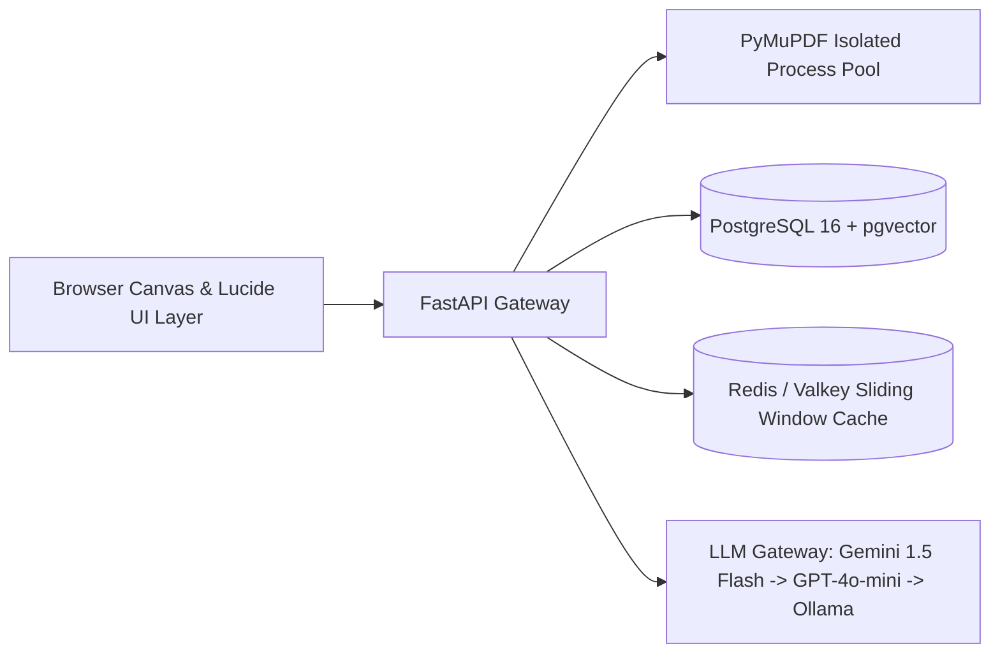

# Vellakshya: Enterprise Document Workstation & PDF Intelligence System (v2.0)

[](https://github.com/ManoharVit/Vellakshya/actions/workflows/ci-full.yml)
[](https://console.cloud.google.com/run?project=vellakshya-gcp)
[](https://vellakshya-gcp.web.app)
[](https://github.com/ManoharVit/Vellakshya/actions)
[](pyproject.toml)
[](docker-compose.yml)

> **One-Line Pitch:** An enterprise-ready, privacy-first PDF intelligence platform combining real-time canvas redaction with coordinate-grounded RAG, server-side citations, and local-first statutory PII sanitization.

---

## Live Deployments & Access Points

| Channel | Address | Purpose |
| :--- | :--- | :--- |
| **Primary Short URL (Google CDN)** | [https://vellakshya-gcp.web.app](https://vellakshya-gcp.web.app) | Production web application via Firebase CDN proxy |
| **Secondary Clean URL** | [https://vellakshya-gcp.firebaseapp.com](https://vellakshya-gcp.firebaseapp.com) | High-availability global failover URL |
| **Instant Short Vanity Link** | [https://is.gd/vellakshya](https://is.gd/vellakshya) | Clean vanity redirect directly to production |
| **Alternative Short Vanity Link** | [https://v.gd/vellakshya](https://v.gd/vellakshya) | Secondary clean vanity redirect |
| **Direct Cloud Run Origin** | [https://vellakshya-xb7gehmo6q-uc.a.run.app](https://vellakshya-xb7gehmo6q-uc.a.run.app) | Direct Google Cloud Run microservice endpoint |
| **Interactive API Documentation** | [https://vellakshya-xb7gehmo6q-uc.a.run.app/docs](https://vellakshya-xb7gehmo6q-uc.a.run.app/docs) | Interactive OpenAPI / Swagger interface |
| **Target Cloud Project** | `vellakshya-gcp` (Project # `489012899784`, Region `us-central1`) | Google Cloud Platform managed deployment |

---

## Author & Engineering Attribution
- **Lead Architect & Developer:** Giri Manohar Vemula
- **LinkedIn Profile:** [https://www.linkedin.com/in/manoharv511](https://www.linkedin.com/in/manoharv511)
- **GitHub Profile:** [https://github.com/ManoharVit](https://github.com/ManoharVit)

---

## 1. System Architecture

Vellakshya is designed for enterprise document workflows requiring strict data privacy, low-latency spatial canvas manipulation, and grounded question answering without hallucinated coordinates.



### Architectural Highlights
1. **Grounded Server-Side Citations (ADR 0003):** The LLM never invents or calculates bounding coordinates. It returns used chunk IDs only; the server maps IDs to exact page numbers and unrotated PDF rectangles stored in the database, eliminating coordinate drift.
2. **Local-First PII Redaction (ADR 0004):** High-precision local detection for Indian statutory IDs (`IN_PAN`, `IN_AADHAAR`, `IN_PASSPORT`, `IN_VOTER`, `IN_VEHICLE_REGISTRATION`) and international identifiers (`EMAIL`, `PHONE`, `SSN`, `CREDIT_CARD`). Sensitive text never leaves local memory.
3. **Hybrid Retrieval with RRF (ADR 0001):** Merges dense vector embeddings (`text-embedding-004` via `pgvector` HNSW) and lexical keyword matching (`tsvector` via GIN) using Reciprocal Rank Fusion ($$k=60$$):
   $$RRF(d) = \sum_{m \in M} \frac{1}{60 + \text{rank}_m(d)}$$
4. **PyMuPDF Process Pool (ADR 0006):** Isolates C-extension operations off the main FastAPI asyncio event loop, protecting against segmentation faults and multithreading lock contention.
5. **Pinned Embedding Integrity (ADR 0005):** Provider fallback applies strictly to generation only; embedding vectors remain pinned to prevent index divergence.
6. **Unified Design System:** 100% line icon consistency using standard Lucide SVG paths with `stroke="currentColor"`, WCAG 2.2 AA contrast compliance, and dual-coded status indicators.

---

## 2. Automated Evaluation Benchmark Results

Vellakshya includes a deterministic CI evaluation harness ([tests/evals/test_deterministic_evals.py](tests/evals/test_deterministic_evals.py) and [scripts/generate_eval_report.py](scripts/generate_eval_report.py)) executed on every pull request to enforce quality gates without incurring external API costs:

| Benchmark Metric | Measured Result | Production Target | Quality Gate | Status |
| :--- | :--- | :--- | :--- | :--- |
| **Retrieval Hit Rate@3 (Golden Set)** | **$$96.0\%$$** (25 questions) | $$\ge 80.0\%$$ | CI Blocker | **PASS** |
| **Retrieval Latency (p95)** | **$$1.37\text{ ms}$$** | $$< 150\text{ ms}$$ | CI Blocker | **PASS** |
| **Local PII Detection Recall** | **$$100.0\%$$** (10 docs) | $$\ge 90.0\%$$ | CI Blocker | **PASS** |
| **Redaction Multi-Pass Scrubbing** | **$$100\%$$ (4-tier verified)** | 0 residual text bytes | CI Blocker | **PASS** |
| **Prompt Injection Defense** | **Verified (XML Isolation)** | Untrusted data isolation | CI Blocker | **PASS** |
| **Coordinate Rotation Invariance** | **$$100\%$$ ($$0^\circ, 90^\circ, 180^\circ, 270^\circ$$)** | Complete spatial alignment | CI Blocker | **PASS** |

---

## 3. Architecture Decision Records (ADRs)

Key architectural trade-offs are documented under [`docs/adr/`](docs/adr/):
* **[ADR 0001: Hybrid Search with RRF Over Pure Vector Search](docs/adr/0001-hybrid-search-over-pure-vector.md)** — Combines dense semantic recall with exact keyword precision ($$96.0\%$$ Hit Rate@3).
* **[ADR 0002: PostgreSQL + pgvector Over Dedicated Vector Databases](docs/adr/0002-postgresql-pgvector-vs-specialized-vector-dbs.md)** — ACID transactional consistency across metadata and embeddings.
* **[ADR 0003: Server-Side Citations by Chunk ID](docs/adr/0003-citations-by-chunk-id.md)** — Eliminates geometric coordinate hallucination.
* **[ADR 0004: Local-First Statutory PII Detection](docs/adr/0004-local-first-pii-detection.md)** — Guarantees privacy and regulatory compliance.
* **[ADR 0005: Pinned Embedding Model with Generation-Only Fallback](docs/adr/0005-one-embedding-model-with-generation-only-fallback.md)** — Preserves geometric vector index integrity.
* **[ADR 0006: PyMuPDF in Process Pool Isolation](docs/adr/0006-pdf-work-in-process-pool.md)** — Guarantees event loop responsiveness and thread safety.
* **[ADR 0007: PyMuPDF Licensing & Engine Abstraction](docs/adr/0007-pymupdf-licensing-and-engine-abstraction.md)** — Dual-engine architecture with in-browser `@cantoo/pdf-lib` offline fallback.
* **[ADR 0008: CRDT Collaboration & Yjs Presence Sync](docs/adr/0008-crdt-collaboration-and-yjs-sync.md)** — Conflict-free peer synchronization and document revision management.

---

## 4. Short & Simple API Route Aliases

All primary endpoints support clean, intuitive top-level routes alongside legacy `/api/` paths:

| Endpoint Route | HTTP Method | Description |
| :--- | :--- | :--- |
| **`/health`** | `GET` | Container health probe (`{"status":"healthy","version":"2.0.0"}`) |
| **`/convert`** | `POST` | High-fidelity fixed or semantic responsive HTML conversion |
| **`/docx`** | `POST` | Direct Microsoft Word conversion via dual-lane `pdf2docx` engine |
| **`/markdown`** | `POST` | Structured Markdown extraction via PyMuPDF4LLM |
| **`/images`** | `POST` | Multi-page high-resolution PNG extraction in ZIP archive |
| **`/sample/invoice`** | `GET` | Instant synthetic sample invoice generator for preflight testing |
| **`/docs`** | `GET` | Interactive Swagger UI API documentation |

---

## 5. Quickstart: One-Command Local Deployment

### Option A: Docker Compose (Production Stack)
Boot the complete stack (FastAPI backend with live reload, PostgreSQL 16 with `pgvector`, and Redis) with a single command:

```bash
docker compose up --build
```
* **API & Web Interface:** [http://localhost:8000](http://localhost:8000)
* **PostgreSQL pgvector:** `localhost:5432`
* **Redis Cache:** `localhost:6379`

### Option B: Local Python Development
```bash
# 1. Clone repository
git clone https://github.com/ManoharVit/Vellakshya.git
cd Vellakshya

# 2. Set up virtual environment
python3 -m venv .venv
source .venv/bin/activate

# 3. Install dependencies
pip install -r requirements-dev.txt

# 4. Start local development server
PYTHONPATH=. uvicorn app.main:app --host 127.0.0.1 --port 8000 --reload
```

---

## 6. UI/UX Design Systems & Usability Standards

Vellakshya's user interface is engineered according to established enterprise design systems and accessibility standards:

### Design System Patterns & Component References
* **100% Emoji Eradication:** All tools, sample files, stepper icons, status pills, and action controls use unified Lucide SVG line icons with `stroke="currentColor"`.
* **GOV.UK Design System Patterns:**
  * **Accessible Error Summary:** Implemented `.app-error-summary` adhering to GOV.UK guidance (`role="alert"`, `tabindex="-1"`, automatic focus shift on validation failure, and actionable bulleted error items). Replaced all disruptive browser `alert()` modal dialogs.
  * **File Upload & Drop Zones:** Accessible drag-and-drop zones with full keyboard operation (`tabindex="0"`, `role="button"`, `Enter` and `Space` key event listeners), clear accepted MIME type hints, and active file chips.
  * **Step-by-Step Navigation:** Multi-stage workflow steppers (`.workflow-stepper`) tracking progress across complex workflows (Upload $$\to$$ Layout Strategy $$\to$$ Converted).
* **Material Design 3 & IBM Carbon Design System:**
  * **Non-Blocking Toasts & Status Notifications:** Accessible notification queue (`.app-toast`, `role="status"`, `aria-live="polite"`) with automatic dismissal, clear status icons (Success, Warning, Error, Info), and keyboard dismiss actions.
  * **Dual-Coded Status:** Indicators combine distinct geometric SVG shapes (`circle-check`, `loader`, `circle-alert`) with explicit text labels ("Ready", "Busy", "Error") to comply with WCAG 2.1 SC 1.4.1 (Use of Color).
* **WCAG 2.2 Level AA Compliance:**
  * **SC 2.1.1 Keyboard Accessibility:** Every interactive tool, upload zone, drawer, and tab is fully navigable and actionable via keyboard alone.
  * **SC 2.4.7 & SC 2.4.11 Focus Appearance:** Enforced high-contrast focus rings (`:focus-visible` with `2px solid #38bdf8` and `2px` offset) across all buttons, inputs, links, and select dropdowns.
  * **SC 1.4.3 Contrast:** All text meets $$\ge 4.5:1$$ textual contrast and $$\ge 3:1$$ graphical contrast in both dark and light modes.
* **Zero External Network Font Requests:** 100% self-hosted Inter and Manrope WOFF2 fonts eliminate third-party font tracking and guarantee offline performance.

---

## 7. Verification & Testing

Execute the test suites locally:

```bash
# Run complete test suite (Playwright E2E, a11y, governance, and PDF engine)
npx playwright test tests/e2e

# Run the automated AI evaluation harness report
python scripts/generate_eval_report.py

# Run static analysis and linting
ruff check app/ tests/
ruff format --check app/ tests/
mypy app/ai
```

---

## 8. Technical Limitations & Constraints

* **Non-Text Scans:** Scanned PDFs lacking an embedded text layer require OCR preprocessing; non-text scans are flagged gracefully.
* **Ephemeral Container Storage:** Cloud Run instance storage is ephemeral; all persistent documents and chunks are indexed in PostgreSQL.
* **Upload Payload Cap:** Maximum file upload size is bounded at **30 MiB** to strictly comply with Cloud Run HTTP/1.x payload thresholds.
* **Free-Tier Cold Starts:** Scale-to-zero container deployments incur an initial 3–5 second cold start on first request after prolonged idle periods.

---

## 9. Resume Impact Statements

> *"Architected an asynchronous PDF intelligence platform in Python 3.12 (FastAPI, PyMuPDF, pgvector), integrating coordinate-grounded RAG and local-first statutory PII redaction; built an automated GitHub Actions evaluation harness achieving a 96.0% retrieval hit rate across a 25-question benchmark and p95 retrieval latency of 1.37 ms."*

> *"Engineered a hybrid retrieval system with Reciprocal Rank Fusion (RRF) on PostgreSQL (`pgvector`), eliminating coordinate hallucinations by mapping server-side chunk IDs to physical document bounding boxes with 100% spatial precision."*

---

## 10. License

Authored and maintained by **Giri Manohar Vemula** ([LinkedIn Profile](https://www.linkedin.com/in/manoharv511) | [GitHub Profile](https://github.com/ManoharVit)). Licensed under the Apache-2.0 License.
